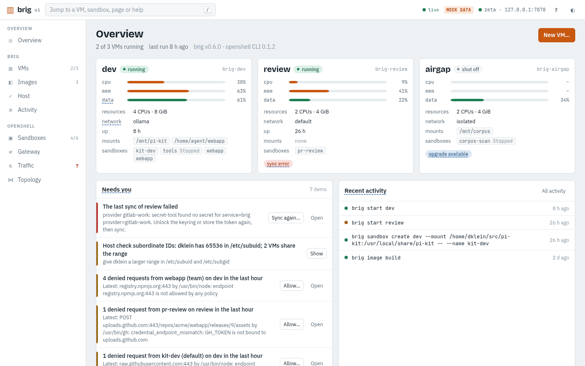

# brig

`brig` manages the lifecycle of agent-sandbox VMs. Each VM runs an [NVIDIA
OpenShell](https://github.com/NVIDIA/OpenShell) gateway, so autonomous agents
are contained by a VM boundary in addition to OpenShell's own sandboxing. Your
host's `openshell` CLI drives each VM's gateway; brig registers it as
`brig-<vm>`.

> **Status:** early development. Expect breaking changes.
>
> brig currently supports and is tested on x86_64 Fedora hosts.

## Install

From brig's package repository, which also has the `openshell` CLI that must
match the VMs' OpenShell version:

```sh
sudo rpm --import https://dennisklein.github.io/brig/RPM-GPG-KEY-brig
sudo dnf install https://dennisklein.github.io/brig/brig-release.noarch.rpm
sudo dnf install brig
brig doctor
```

[Install](docs/start/install.md) also covers mise, `go install` and the
shell integration that `brig use` needs. Open a new terminal after installing
the package.

## Quick start

```sh
brig create dev                 # builds a base image first if needed
brig list
brig use dev                    # point this shell's openshell CLI at the VM's gateway
openshell sandbox create        # a shell in OpenShell's default image
brig ssh dev                    # a shell in the VM, as the gateway's user
```

Keep `dev`: the guides build on it. [Your first VM](docs/start/first-vm.md)
explains what you now have, and [your first agent](docs/start/first-agent.md)
puts Claude Code, Pi or opencode into a sandbox on it.

`brig ui` shows the same VMs, sandboxes and traffic in a web UI, and runs the
same commands:

<picture>
  <source media="(prefers-color-scheme: dark)" srcset="docs/images/overview-dark.png">
  
</picture>

[The web UI](docs/how-to/web-ui.md) describes it, and
[its reference](docs/reference/ui.md) shows every page.

## Documentation

[docs/](docs/index.md) is organised by what you want to do:

- **Start:** [install](docs/start/install.md), [first VM](docs/start/first-vm.md),
  [first agent](docs/start/first-agent.md)
- **How to:** [daily workflow](docs/how-to/daily-workflow.md),
  [unblock an agent](docs/how-to/unblock.md),
  [Git access](docs/how-to/git-access.md),
  [share directories](docs/how-to/share-directories.md),
  [upgrade](docs/how-to/upgrade.md), [the web UI](docs/how-to/web-ui.md) and
  [more](docs/index.md#how-to)
- **Understand:** [architecture](docs/concepts/architecture.md),
  [OpenShell config](docs/concepts/openshell-config.md),
  [services](docs/concepts/services.md),
  [disks and images](docs/concepts/disks-and-images.md),
  [audit trail](docs/concepts/audit-trail.md)
- **Look up:** [commands](docs/reference/cli/README.md),
  [configuration](docs/reference/config.md),
  [exit codes](docs/reference/exit-codes.md),
  [troubleshooting](docs/troubleshooting.md)
- **Contribute:** [development](docs/contributing/development.md),
  [releasing](docs/contributing/releasing.md),
  [packaging](docs/contributing/packaging.md)

In a terminal, `brig COMMAND --help` describes each command and `brig help
topics` lists the concepts and how-tos that `brig help TOPIC` explains, such
as `brig help fence-2`. `brig ui` explains its pages when you press `?`.

## License

Apache-2.0. See [LICENSE](LICENSE) and [NOTICE](NOTICE). The web UI embeds
htmx (0BSD) and the IBM Plex Sans, JetBrains Mono and Bricolage Grotesque
fonts (OFL-1.1); their licenses are in
[internal/ui/web/static/licenses](internal/ui/web/static/licenses).
