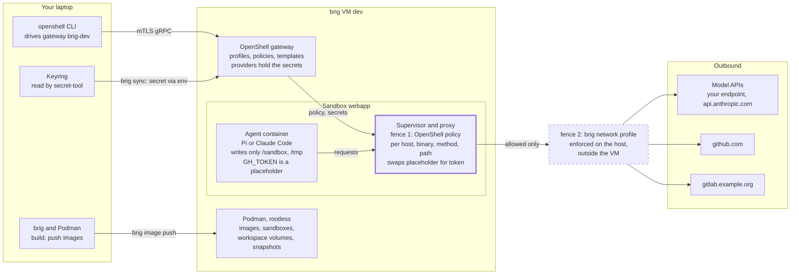

# Architecture

You drive everything from your laptop. brig gives each VM its own OpenShell
gateway, the gateway runs each agent in a sandbox container, and everything a
sandbox sends leaves through that sandbox's proxy and then through the VM's
network profile.

## Host

- **brig** creates, starts and upgrades VMs, applies [config
  directories](openshell-config.md#config-directories) to their gateways, and
  serves [the web UI](../how-to/web-ui.md).
- **The `openshell` CLI** drives a VM's gateway over mTLS gRPC. brig registers
  each gateway as `brig-NAME` and copies the gateway's client certificate and
  key into the CLI's configuration. `brig use dev` (with the [shell
  integration](../start/install.md#shell-integration); else `eval "$(brig env
  dev)"`) points the current shell's CLI at `brig-dev`.
- **The keyring** (GNOME Keyring or KeePassXC, read by `secret-tool`) holds
  the secrets that providers send.
- **The audit collector**, a systemd user unit per running VM, records what
  its sandboxes did; see [audit trail](audit-trail.md).

## VM

VMs run rootless in your libvirt user session (`qemu:///session`) with UEFI,
KVM and passt user-mode networking. They show up in virt-manager as
`brig-<vm>`, but start them with `brig start`, which also starts their
network.

Each VM runs headless Fedora. The gateway runs as user `agent`, keeps its
state on the data disk at `/home/agent`, and starts sandboxes as rootless
Podman containers. A rootless Docker runs as user `dockerd`, for the
sandboxes that you let use it; see [Docker in a sandbox](../how-to/docker.md). The configuration of each boot (SSH keys, hostname,
mounts) is passed as systemd credentials; there is no cloud-init. [Disks and
images](disks-and-images.md) describes what the VM boots from and what
survives an upgrade.

## Sandbox

A sandbox is a container from the image you pass to `--from` or name in a
template, with its workspace at `/sandbox`. Its supervisor and proxy enforce
its [policy](openshell-config.md#which-policy-a-sandbox-gets) and hold its
providers' secrets; the agent's container sees only placeholders.

## The two fences

A request leaves only if both fences allow it:

- **Fence 1, the sandbox policy.** OpenShell's proxy in each sandbox checks
  every request against the sandbox's policy, per host, port, binary, method
  and path. Changes to network rules reload at once. The proxy adds a
  provider's real token only on requests to that provider's endpoints.
- **Fence 2, the network profile.** The VM's network profile restricts what
  the whole VM may reach: the internet, the LAN, services on the host. It is
  enforced outside the VM, so even root in the VM cannot lift it: each VM's
  passt runs in a private network namespace, connected to the host by pasta,
  whose nftables rules brig sets up without root privileges. A change applies
  when the VM next starts.

[Network profiles](../reference/network-profiles.md) lists the built-in
profiles, and [configuration](../reference/config.md) how to add your own.

## Network profiles in detail

The host is reachable from a VM at the VM's default gateway address; with
`host_ports`, only those TCP ports are. Without `host`, the host's own
addresses are blocked too. The LAN means the private, shared (100.64.0.0/10),
link-local, multicast and broadcast address ranges plus the networks of the
host's addresses and of its routes, in any routing table, other than default
ones, such as a VPN's or Tailscale's intranet. A running VM's rules follow
them within a second when the host joins another network, gets a new address
or connects a VPN.

A profile that allows the internet, the LAN or the host also gets DNS from the
host's resolver, for any name; other profiles, such as `isolated` or one with
only `host_ports`, get none.

A VM's gateway pulls OpenShell's container images from ghcr.io and nvcr.io and
refreshes provider tokens itself, so profiles without `internet` need images
pushed into the VM with `brig image push`.

## Where secrets go

Provider secrets never reach the host's disk or a command line. Your host's
`openshell` CLI sends them straight to the VM's gateway, either when you
create a provider yourself or when `brig sync` reads them from your keyring
and hands them to the CLI in its environment. The gateway stores them
encrypted on the VM's data disk, next to the key that decrypts them, so treat
a VM's directory as holding its secrets. Inside a sandbox, the agent sees a
[placeholder](openshell-config.md#placeholders) instead.
