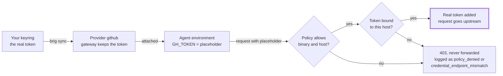

# OpenShell configuration

What a sandbox may do and which credentials it gets lives in its VM's
gateway. This page explains the objects there, which policy a sandbox ends up
with, and how brig keeps a gateway in step with directories on your host.

## Objects on a gateway

Six objects do all the work:

| Object | What it is | Holds secrets | Created with | Lives |
| --- | --- | --- | --- | --- |
| Gateway | The control plane of one brig VM, registered on the host as `brig-NAME` | Yes, providers' | `brig create` | VM data disk |
| Workspace | A tenant inside a gateway; brig ui and brig sync work in all of them | No | built in | gateway |
| Provider profile | A type definition: which env vars hold the credential, how it is sent (bearer, header, Basic, query), to which endpoints, from which binaries | No | `openshell profile import -f FILE` (workspace) or `--global` (platform) | gateway |
| Provider | A named instance of a profile with your actual token | Yes | `brig sync` from a [config directory](#config-directories) | gateway |
| Policy | Filesystem, process and network rules for one sandbox | No | `--policy FILE` or `OPENSHELL_SANDBOX_POLICY` at create; `openshell policy set` later | sandbox record |
| Sandbox | A container running your agent image, with workspace `/sandbox` | Placeholders only | `openshell sandbox create --from IMAGE` | Podman in the VM |

A gateway starts with no profiles. OpenShell's
[`providers/`](https://github.com/NVIDIA/OpenShell/tree/v0.1.4/providers)
directory has examples, such as `github.yaml`, `openai.yaml` and
`claude-code.yaml`, to copy and adapt: their `binaries` must name the
executables in your image. [Workspaces](workspaces.md) explains the tenants
inside a gateway.

## Providers and sandboxes

A sandbox can carry several providers (`--provider llm --provider github`), and
one provider can serve many sandboxes. Attach or detach later with `brig
sandbox attach dev SANDBOX PROVIDER` or `openshell sandbox provider attach`;
only processes the sandbox starts afterwards see the change: a new `openshell
sandbox exec` shell, or every process after `openshell sandbox stop` and
`start`. A program restarted from a shell that was already open keeps the old
variables. Each attached provider also adds a network rule named
`_provider_<name>` to the sandbox's effective policy, so attaching `github` is
what opens `api.github.com` and `github.com`.

### Placeholders



The agent's environment holds only a placeholder such as
`openshell:resolve:env:GH_TOKEN`. The proxy swaps in the token, in headers,
Basic auth, query strings and URL paths, only on requests the policy allows
and only to the profile's endpoints; endpoints can also opt in to rewriting
JSON, form and text bodies and WebSocket messages. A profile's `binaries`
decide which processes its network rule admits. Client certificates and SSH
keys cannot be provided this way, so use HTTPS remotes for git.

## Which policy a sandbox gets

OpenShell picks the first that exists:

1. A global policy set on the gateway.
2. The policy given at create: `--policy FILE`, or the file named by
   `OPENSHELL_SANDBOX_POLICY`, which `brig use` sets from your config
   directory.
3. `/etc/openshell/policy.yaml` baked into the image.
4. The built-in default: workdir and `/tmp` writable; `/usr`, `/lib`, `/etc`
   and a few more read-only; no network at all.

### Base and effective policy

What OpenShell picked is the **base** policy, together with the rules added to
the sandbox since, such as with `brig policy allow`. The **effective** policy
adds the rules of attached providers; compare them with `openshell policy get
SANDBOX --base` and `--full`. Network rules hot-reload with `openshell policy
set` or `openshell policy update`; filesystem and process settings are fixed
once a sandbox starts.

### Audit mode

To learn what an agent needs, set `enforcement: audit` on a new rule so it
logs instead of blocking; this works only for hosts no attached provider
covers, because overlapping endpoints must agree on enforcement. On an
inspected endpoint of your own, `audit` is the default, so always set
`enforcement: enforce` where you mean to enforce.

## Config directories

Keep profiles, providers and the default policy in directories, not in your
shell history. brig applies them to a VM's gateway at every `brig start` and
on `brig sync`, so a new or rebuilt VM is set up in one command. Split them in
two: a shared directory without secrets, which can live in git, and a personal
one that only points into your keyring.

```text
~/src/agent-openshell/              # shared, in git
  profiles/
    llm.yaml                        # your own, see Agents
    claude-code.yaml                # OpenShell's, edited, see Agents
    github.yaml                     # copy of OpenShell's, binaries checked
    gitlab-work.yaml                # your own, see Git access
  policies/
    default.yaml                    # default policy for new sandboxes
    webapp.yaml                     # a project's policy, see Git access
~/.config/brig/openshell/           # personal, never in git
  providers/
    llm.yaml
    claude-code.yaml
    github.yaml
    gitlab-work.yaml
```

A provider file names the profile it instantiates and where each credential is
in your keyring; brig refuses values.

```yaml
# ~/.config/brig/openshell/providers/github.yaml
name: github
type: github                      # profile id
credentials:
  GH_TOKEN:
    secret_tool:                  # the arguments of `secret-tool lookup`
      lookup: [service, github.com, user, alice]
```

brig looks the secret up as `secret-tool lookup application brig service
github.com user alice`: it adds [its namespace](../how-to/secrets.md#brigs-namespace),
so a shared directory cannot name a secret that another program keeps in
your keyring.

Attach directories with `brig create --openshell-config DIR` or `brig update
--add-openshell-config DIR`, or list defaults for new VMs in `openshell.configs`
in `~/.config/brig/config.yaml`. [Secrets](../how-to/secrets.md) shows how to
store what the provider files point at.

```sh
brig update dev --add-openshell-config ~/src/agent-openshell \
                --add-openshell-config ~/.config/brig/openshell
brig sync dev --dry-run      # what would change, and where each token may be sent
brig sync dev
```

### The default policy

The default policy is a complete policy file. Keep it small and without
network rules, since attached providers add theirs. Once a file has a
`filesystem_policy`, the workspace is writable only with `include_workdir:
true`:

```yaml
# policies/default.yaml
version: 1
filesystem_policy:
  include_workdir: true          # /sandbox
  read_only: [/bin, /usr, /lib, /etc, /proc, /dev/urandom, /var/log]
  read_write: [/tmp, /dev/null]
landlock:
  compatibility: best_effort
```

### What a sync does

| Item | Applied as | Updated when | Deleted |
| --- | --- | --- | --- |
| `profiles/*.yaml` | workspace profile, overriding a `--global` one with the same id | the file changes | only with `--prune`, only if brig created it |
| `providers/*.yaml` | provider; secrets reach `openshell` only in its environment | a keyed fingerprint of a secret changes, or `--refresh-secrets` | only with `--prune`, only if brig created it |
| `policies/default.yaml` | exported by `brig use dev` as `OPENSHELL_SANDBOX_POLICY` | read at each `openshell sandbox create` | never; running sandboxes keep their policy |

`profiles/` and `providers/` are for the gateway's `default` workspace; see
[workspaces](workspaces.md#config-directories) for others.

A profile, provider or default policy defined in two directories is an error
(within one workspace, for profiles and providers). Files whose names start
with a dot, such as an editor's lock file, are ignored. Profiles and providers
you created by hand are touched only when a directory defines them. A sync
does not touch templates, global policies or the policies of existing
sandboxes. Without `--prune`, brig never deletes anything.

### Sharing a directory safely

Two safety rules matter when you share a directory. A provider's secret may be
sent to every endpoint in its profile, so read a shared profile's `endpoints`
before pairing it with your token; `brig sync --dry-run` prints them. And `brig
start` holds back a change of a profile whose credentials the gateway already
holds, unless the change is only to `display_name`, `description` or
`category`. Everything else can change where or how the credentials go: new
endpoints, an endpoint's path or rules, no endpoints at all (so sandbox
policies decide), a `credentials` entry such as a refresh `token_url`, or
`binaries`. Only an explicit `brig sync` applies it, and it names the new
endpoints and the keys that changed.

Config directories cannot set the program that looks up secrets, so a shared
one cannot run programs on your host; see [secrets](../how-to/secrets.md).
