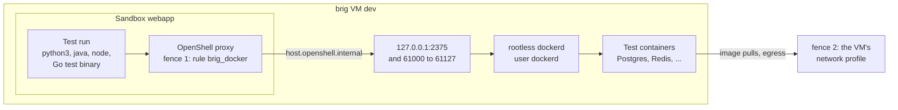

# Docker in a sandbox

Test suites often start their databases and services in containers, with
[testcontainers](https://testcontainers.com/) or `docker compose`. Every brig
VM runs a rootless Docker for that, which a sandbox may use once you let it.
Sandboxes that you do not let in cannot reach it.

## Let a sandbox use Docker

Give `--docker` when you create the sandbox:

```sh
brig sandbox create dev --docker -- --name webapp --from localhost/webapp-ci:2026-10-20
```

brig then does three things:

- It adds the rule `brig_docker` to the sandbox's policy. The rule lets the
  docker CLI and the usual runtimes reach Docker's API at
  `host.openshell.internal:2375`, and the ports at which Docker publishes
  containers, 61000 to 61127.
- It sets `DOCKER_HOST`, `TESTCONTAINERS_HOST_OVERRIDE` and
  `TESTCONTAINERS_DOCKER_SOCKET_OVERRIDE` in the sandbox, so that the docker
  CLI and testcontainers find the daemon.
- It labels the sandbox `brig.dev/docker=true`.

Docker starts the first time a sandbox calls it, so a VM whose sandboxes
never use it does not run it.



### Where the rule goes

A sandbox's policy is fixed when it is created, so brig puts the rule into
the policy that the sandbox gets:

1. The file that `--policy` names after `--`.
2. Else the VM's default policy, from your [config
   directories](../concepts/openshell-config.md#config-directories).
3. Else OpenShell's built-in default. A policy that the sandbox's image ships
   at `/etc/openshell/policy.yaml` is then not used.

brig does not change the file on disk: it hands openshell the file with the
rule added. `brig policy diff` does not count the rule as a difference, and
`brig sandbox recreate --policy` keeps it.

### With a template

`openshell sandbox create` takes no environment together with `--template`.
brig still adds the rule, and prints the variables to set in the sandbox:

```sh
brig sandbox create dev --docker -- --name webapp --template pi
```

## testcontainers

testcontainers for Java, Go, Python and Node talks to Docker's API itself, so
the sandbox's image needs no docker CLI. With the variables that brig sets,
it finds the daemon, connects to the containers it starts through
`host.openshell.internal`, and starts its cleanup container, Ryuk, with
dockerd's socket.

Docker picks the host port of each container from 61000 to 61127, which the
rule allows. That is 128 ports for all the sandboxes of a VM that use Docker
at the same time.

## docker and docker compose

For `docker` and `docker compose` in scripts, the image needs the docker CLI
and its compose plugin, from the distribution, such as `docker-cli` and
`docker-compose` on Fedora, or from Docker's own packages.

A compose file that publishes a fixed port must use one from 61000 to 61127,
on the VM's loopback, or the rule does not let the sandbox reach it:

```yaml
services:
  db:
    image: postgres:17
    ports: ["127.0.0.1:61100:5432"]
```

The tests then connect to `host.openshell.internal:61100`.

## Which programs may call Docker

OpenShell admits a connection only from the programs that a rule lists, by
the path of the running executable. `brig_docker` lists:

| Programs | Paths |
| --- | --- |
| docker CLI and compose | `/usr/bin/docker`, `/usr/local/bin/docker`, `docker-compose` in the same directories, the CLI plugin directories |
| Python | `/usr/bin/python3*`, `/usr/local/bin/python3*` |
| Java | `/usr/lib/jvm/**/bin/java`, `/opt/java/**/bin/java` |
| Node.js | `/usr/bin/node`, `/usr/local/bin/node` |
| Go test binaries | `/tmp/go-build*/**` |

The list keeps other programs, such as `curl`, off Docker. It is no strong
boundary: each runtime in it can drive Docker in full. The real boundary is
`--docker` itself.

For another program, such as `dotnet`, put a `brig_docker` rule of your own
into the sandbox's policy file. brig keeps a rule of that name that the file
already has:

```yaml
network_policies:
  brig_docker:
    name: brig_docker
    endpoints:
      - host: host.openshell.internal
        ports: [2375, 61000, 61001, 61002]
        protocol: tcp
    binaries:
      - path: /usr/share/dotnet/dotnet
```

## What you trade

- **Containers run outside fence 1.** A container that the sandbox starts
  through Docker is not in the sandbox, so its own traffic is not checked by
  the sandbox's policy. The VM's [network
  profile](../concepts/architecture.md#the-two-fences), fence 2, still holds,
  and must allow the registries that images come from, such as
  `registry-1.docker.io`.
- **The sandbox controls Docker.** It can start any container, mount
  anything that dockerd can read, and see the containers of other sandboxes
  in the VM that use Docker. Let only sandboxes of one trust level use Docker
  in the same VM.
- **Docker cannot read the gateway.** dockerd runs as user `dockerd`, which
  owns nothing but its home and cannot enter `/home/agent`, where the gateway
  keeps its state and the providers' secrets. A sandbox that takes over Docker
  gets only that user.

## Limits of rootless Docker

Rootless Docker runs what ordinary test suites need: databases, message
brokers, web services, compose stacks. It does not run privileged
containers, containers that need devices, Docker in Docker, or kind, and it publishes no
ports below 1024.

## Where Docker keeps its data

Images, containers and volumes live on the VM's [data
disk](../concepts/disks-and-images.md#disks), in
`/home/agent/.local/share/brig/docker`, which the VM mounts as user
`dockerd`'s home. `brig upgrade` keeps them, and `brig delete` deletes them
with the VM. They count against the data disk: `docker system prune` in a
sandbox frees space.

A VM from a base image built before brig had Docker has no `dockerd`. Build
a new image and upgrade the VM, as in [Upgrade](upgrade.md).

## When Docker does not answer

dockerd runs as a user unit of `dockerd` in the VM. Look at its state and
log as root:

```sh
brig ssh dev --root -- systemctl --user -M dockerd@ status brig-docker.service
brig ssh dev --root -- journalctl _UID=1001 -n 50
```

If the sandbox's calls fail before they reach Docker, `brig policy diff dev
webapp` and the sandbox's denied connections in [brig
ui](web-ui.md) show whether the rule admits the program.
