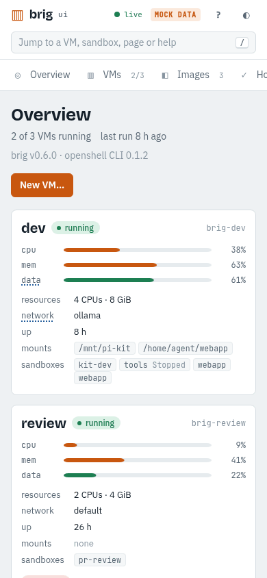
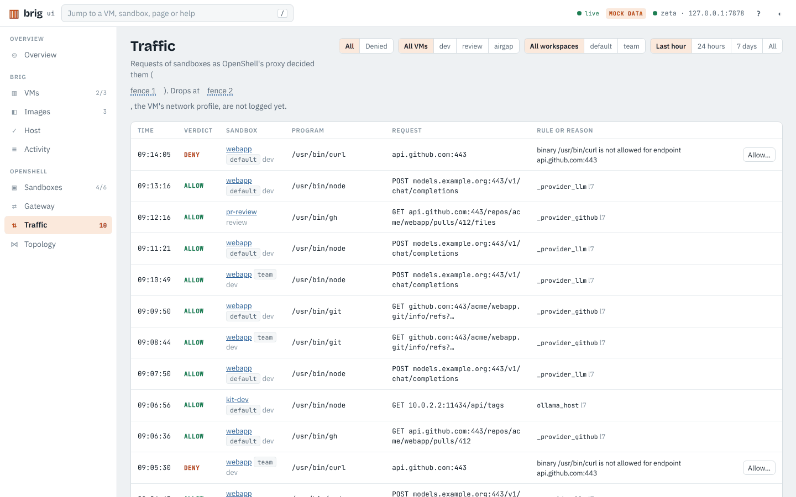
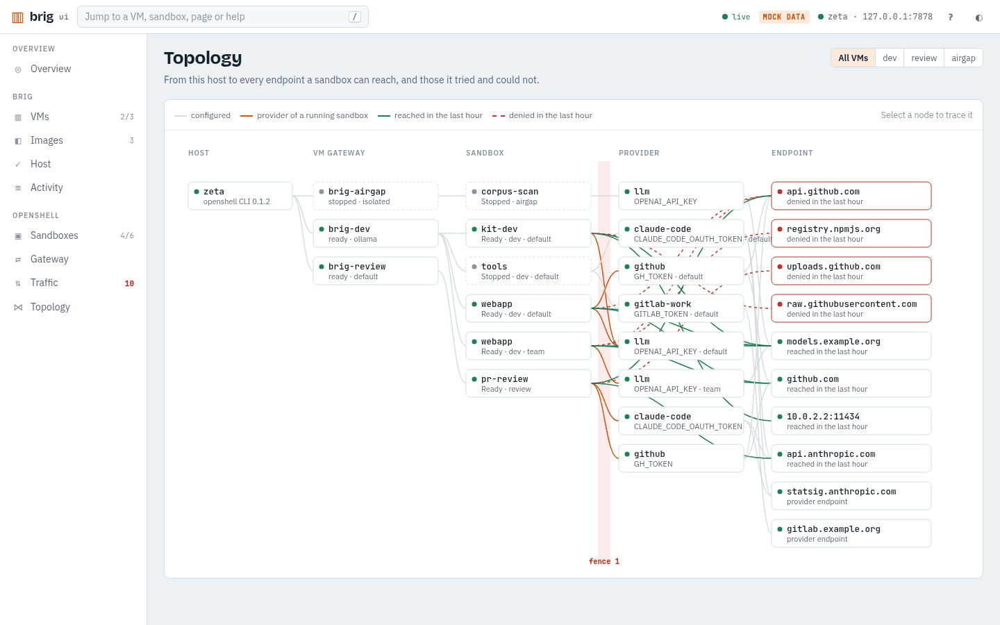
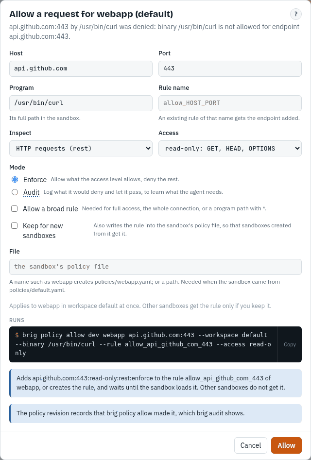
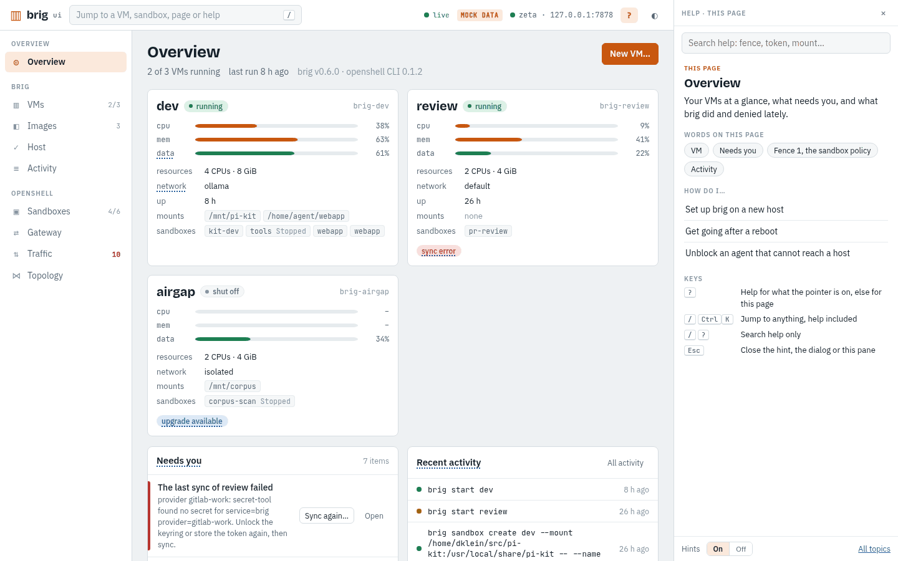

# The web UI

`brig ui` serves a web UI on 127.0.0.1 and opens it in your browser. It shows
the same VMs, gateways and sandboxes as the CLI, runs the same commands, and
shows each command before it runs it. [UI reference](../reference/ui.md)
lists every page and action.

## What it shows

Your VMs with their state, CPU and memory use, mounts, network profile,
OpenShell config directories and last sync; what needs your attention; the
`brig doctor` checks; and what brig did, from the [activity
log](scripting.md#the-activity-log). From each running VM's OpenShell gateway,
which it reads over gRPC with the client certificate `brig start` keeps, it
shows the sandboxes with their providers and base and effective policies, and
the gateway's providers, provider profiles, default policy and templates;
credentials only by name. Pages update live.

<picture>
  <source media="(prefers-color-scheme: dark)" srcset="../images/overview-dark.png">
  
</picture>

In a narrow window the navigation moves to the top.

<picture>
  <source media="(prefers-color-scheme: dark)" srcset="../images/overview-phone-dark.png">
  
</picture>

## Traffic and history

Traffic shows each sandbox's requests as OpenShell's proxy decided them, from
the gateway's log of the last hour, with the rule that allowed a request or
the reason it was denied; a line brig ui cannot read shows as it came, and URL
queries are cut, since they may hold tokens. Denials of the last hour show on
the Overview, under Needs you and on the sandbox's Traffic tab. Topology draws
the path from this host through each gateway and sandbox to the providers'
endpoints and the hosts sandboxes reached or were denied. Drops by a VM's
network profile are not logged yet.

<picture>
  <source media="(prefers-color-scheme: dark)" srcset="../images/traffic-dark.png">
  
</picture>

<picture>
  <source media="(prefers-color-scheme: dark)" srcset="../images/topology-dark.png">
  
</picture>

Traffic also reads the [audit trail](../concepts/audit-trail.md): pick 24
hours, 7 days or all instead of the last hour, and a sandbox that was deleted,
whose history stays. A sandbox's History tab lists its policy revisions with
who made each, its drafts and lifecycle, and the endpoints it reached in the
last week. Host shows each VM's collector, its gaps and the space its history
takes by sandbox, and **Prune…** runs `brig audit prune`. A running VM whose
traffic nothing records shows under Needs you.

**Allow…** on a denied request adds a rule for that sandbox, and can keep it
in the sandbox's policy file; [unblock an agent](unblock.md#allow-it-for-this-sandbox)
describes it.

<picture>
  <source media="(prefers-color-scheme: dark)" srcset="../images/allow-dark.png">
  
</picture>

## What it changes

Start, stop, create, delete and upgrade a VM, change its mounts, config
directories, profile, CPUs, memory and disks, preview and run `brig sync`, and
build, prune and push base images. For sandboxes it creates them from a
template or an image with providers, a policy file and host directories
(`brig sandbox create`), starts, stops and deletes them, and attaches and
detaches providers (`openshell`, always with `-g brig-NAME`).

Every change is a dialog that shows the `brig` or `openshell` command it runs,
with a Copy button, and runs exactly that command; the browser never sends a
command line. Deleting a VM or a sandbox asks you to type its name. A running
command is a card with its steps and, if it failed, its output. A VM's
buttons wait while a command works on it. Ctrl-C in the terminal that runs
`brig ui` interrupts the running commands the way it does in a shell, so brig
rolls back. The UI shows and takes no secrets: store them with [brig secret
set](secrets.md).

Connect shows the commands to run in your own terminal; there is no terminal
in the browser. A sandbox's Files tab lists `/sandbox` and its directories by
running one read-only `find` in the sandbox through its gateway, and shows
the command that does the same.

## Help in the UI

The UI explains itself when asked and stays quiet otherwise. A dotted word
shows what it means when the pointer rests on it, and a button what it runs
and whether it can be undone; a word you have looked at loses its dots. `?`
opens help for what the pointer is on, the open dialog or the page, with its
words, its how-tos with a **Show me** link and their commands; the jump box
finds help too, and only help after a `?`. The help pane's **Hints Off** turns
the cards off; `?` keeps working. The texts are those of `brig help TOPIC`,
and each links to its page in these docs.

<picture>
  <source media="(prefers-color-scheme: dark)" srcset="../images/help-dark.png">
  
</picture>

## Who can open it

Only you can open it. It prints a URL with a token that is new each run and
swaps it for a cookie, answers only to `127.0.0.1:PORT`, refuses
connections from other users' processes, and loads nothing from the
network. A second `brig ui` opens the running one. `--port` picks the port,
`--no-open` only prints the URL, and `--demo` serves made-up VMs without
touching the host.
