<!-- Generated by go generate ./...; do not edit. -->

# brig ui pages and actions

What each page of `brig ui` shows and what each of its actions does. The help pane of `brig ui` (press `?`) shows the same texts. Every action runs a command that its dialog shows first, and Activity keeps afterwards.

## Pages

### Overview

Your VMs at a glance, what needs you, and what brig did and denied lately.

<picture>
  <source media="(prefers-color-scheme: dark)" srcset="../images/overview-dark.png">
  
</picture>

Words: [VM](glossary.md#vm), [Needs you](glossary.md#needs-you), [Fence 1, the sandbox policy](glossary.md#fence-1), [Activity](glossary.md#activity).

How to: [Set up brig on a new host](glossary.md#first-vm), [Get going after a reboot](glossary.md#start-of-day), [Unblock an agent that cannot reach a host](glossary.md#unblock).

### VMs

Every VM on this host. Each runs one OpenShell gateway, registered here as brig-NAME.

<picture>
  <source media="(prefers-color-scheme: dark)" srcset="../images/vms-dark.png">
  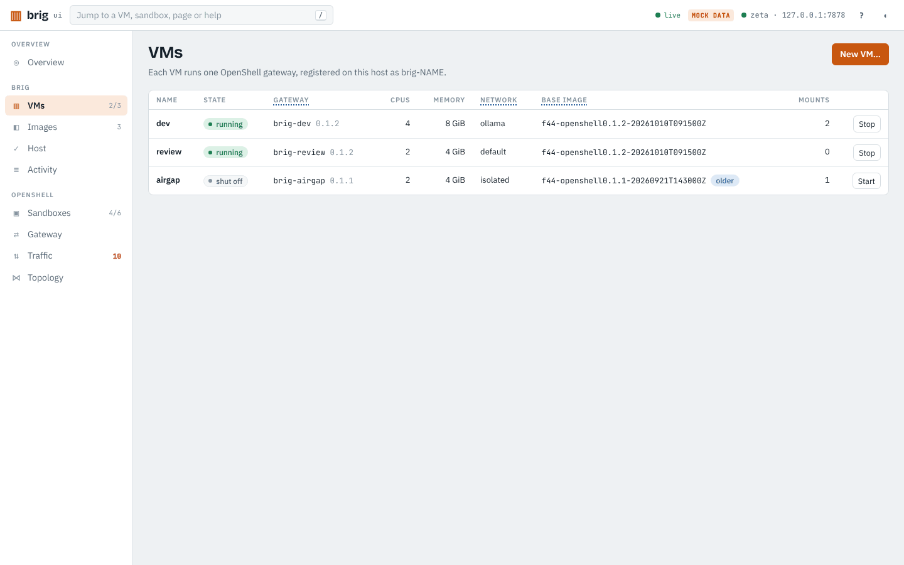
</picture>

Words: [VM](glossary.md#vm), [Gateway](glossary.md#gateway), [Fence 2, the network profile](glossary.md#fence-2), [Base image](glossary.md#base-image).

How to: [Set up brig on a new host](glossary.md#first-vm), [Get going after a reboot](glossary.md#start-of-day), [Move a VM onto a newer base image](glossary.md#upgrade-vm).

### VM

One VM, its disks, host directories, sandboxes, OpenShell config and network.

<picture>
  <source media="(prefers-color-scheme: dark)" srcset="../images/vm-dark.png">
  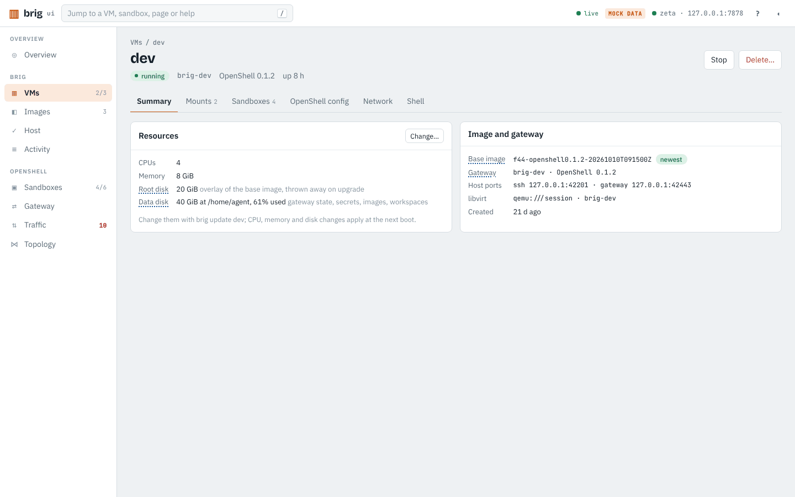
</picture>

<picture>
  <source media="(prefers-color-scheme: dark)" srcset="../images/vm-mounts-dark.png">
  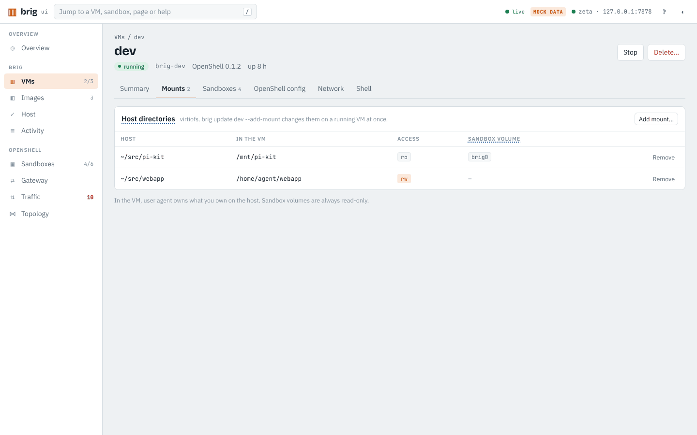
</picture>

<picture>
  <source media="(prefers-color-scheme: dark)" srcset="../images/vm-network-dark.png">
  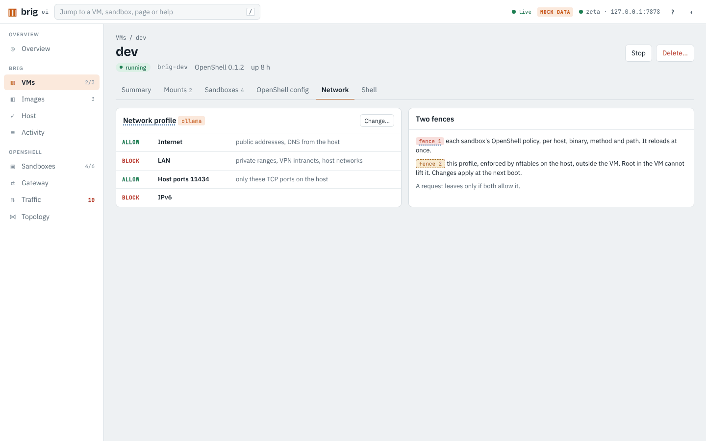
</picture>

Words: [VM](glossary.md#vm), [Gateway](glossary.md#gateway), [Data disk](glossary.md#data-disk), [Root disk](glossary.md#root-disk), [Base image](glossary.md#base-image).

How to: [Share a host directory with a sandbox](glossary.md#share-dir), [Work with a VM from my terminal](glossary.md#terminal), [Move a VM onto a newer base image](glossary.md#upgrade-vm), [Find out why a request fails that the policy allows](glossary.md#blocked-outside).

Tab `mounts`: [Host directory](glossary.md#mount), [Sandbox volume](glossary.md#sandbox-volume).

Tab `network`: [Fence 2, the network profile](glossary.md#fence-2), [Fence 1, the sandbox policy](glossary.md#fence-1).

Tab `openshell`: [Config directory](glossary.md#config-dir), [Sync](glossary.md#config-sync), [Provider](glossary.md#provider).

Tab `sandboxes`: [Sandbox](glossary.md#sandboxes), [Gateway](glossary.md#gateway).

Tab `shell`: [Using a VM from a terminal](glossary.md#brig-use).

Tab `summary`: [Data disk](glossary.md#data-disk), [Root disk](glossary.md#root-disk), [Base image](glossary.md#base-image), [Gateway](glossary.md#gateway).

### Images

The base images that VMs are made from. Sandbox images live in each VM.

<picture>
  <source media="(prefers-color-scheme: dark)" srcset="../images/images-dark.png">
  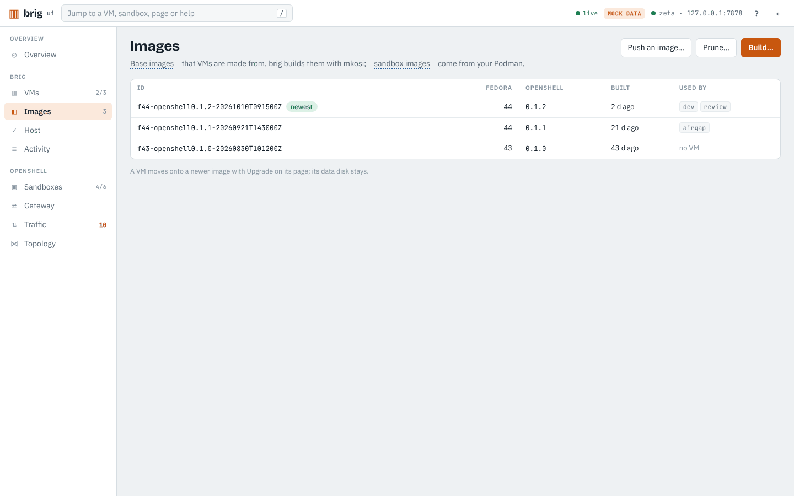
</picture>

Words: [Base image](glossary.md#base-image), [Sandbox image](glossary.md#sandbox-image), [Root disk](glossary.md#root-disk).

How to: [Move a VM onto a newer base image](glossary.md#upgrade-vm).

### Host

brig doctor on this host, which checks what brig needs and says how to fix what fails, and the audit trail that brig keeps of each VM.

<picture>
  <source media="(prefers-color-scheme: dark)" srcset="../images/host-dark.png">
  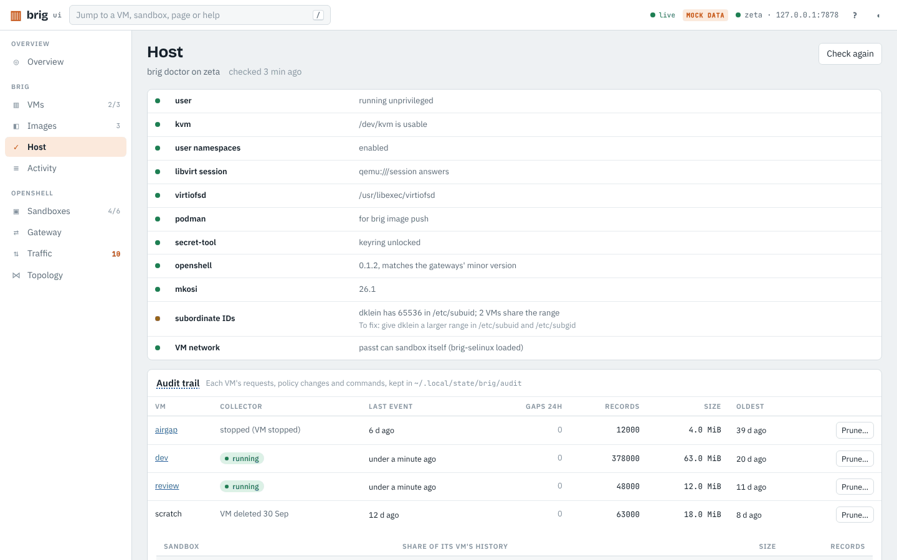
</picture>

Words: [Audit trail](glossary.md#audit-trail).

How to: [Set up brig on a new host](glossary.md#first-vm), [See what a sandbox did and who changed its policy](glossary.md#look-back).

### Activity

What brig did, from brig ui or a terminal, newest first. Open an entry for its steps.

<picture>
  <source media="(prefers-color-scheme: dark)" srcset="../images/activity-dark.png">
  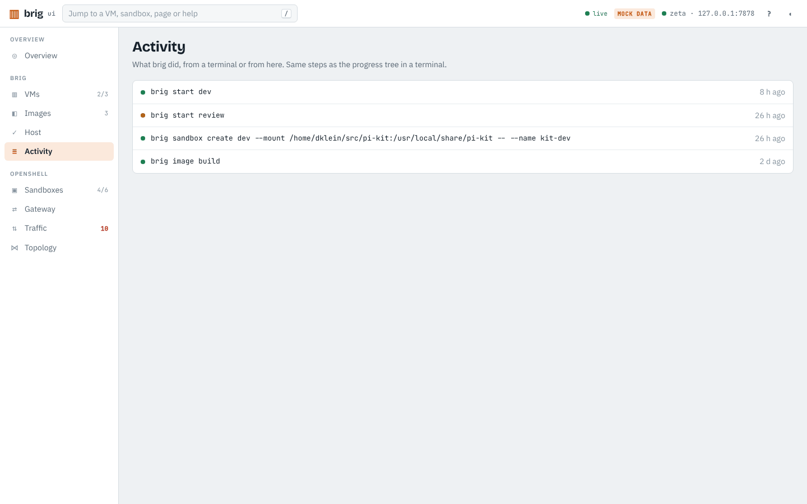
</picture>

Words: [Activity](glossary.md#activity).

### Sandboxes

Every sandbox on every VM's gateway. Each keeps its files at /sandbox across stop and start.

<picture>
  <source media="(prefers-color-scheme: dark)" srcset="../images/sandboxes-dark.png">
  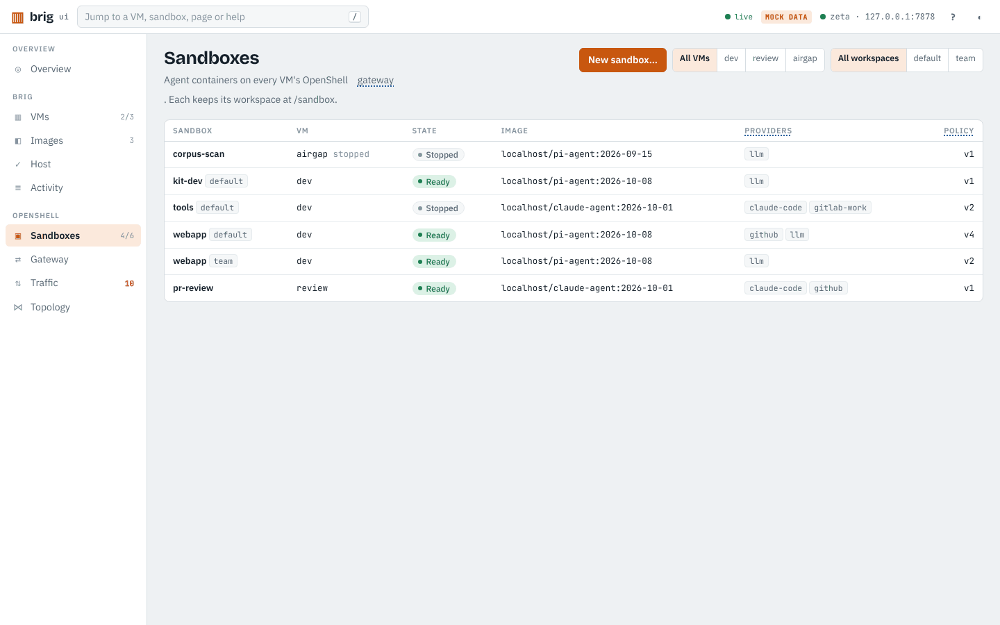
</picture>

Words: [Sandbox](glossary.md#sandboxes), [Workspace](glossary.md#workspace), [Provider](glossary.md#provider), [Sandbox policy](glossary.md#policies).

How to: [Start an agent in a new sandbox](glossary.md#new-sandbox), [Set up Claude Code, Pi or opencode](glossary.md#set-up-agent), [Share a host directory with a sandbox](glossary.md#share-dir), [Run a task in a throwaway sandbox](glossary.md#one-shot).

### Sandbox

One sandbox, its providers and setup, its policy, its traffic, its files and its history.

<picture>
  <source media="(prefers-color-scheme: dark)" srcset="../images/sandbox-dark.png">
  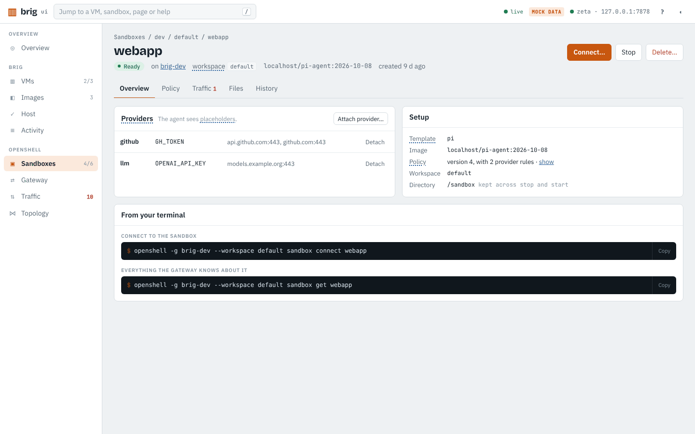
</picture>

<picture>
  <source media="(prefers-color-scheme: dark)" srcset="../images/sandbox-policy-dark.png">
  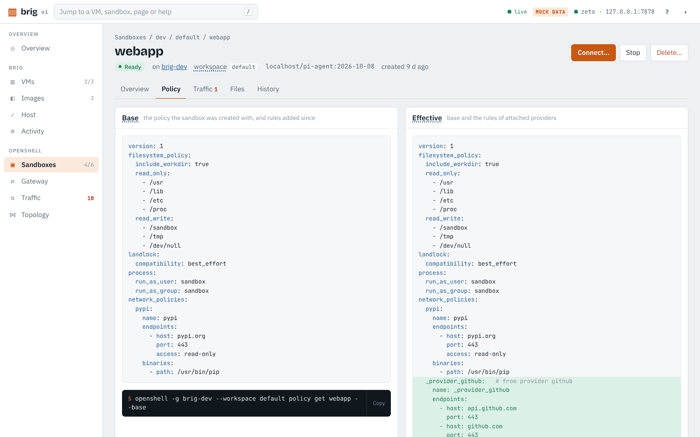
</picture>

<picture>
  <source media="(prefers-color-scheme: dark)" srcset="../images/sandbox-traffic-dark.png">
  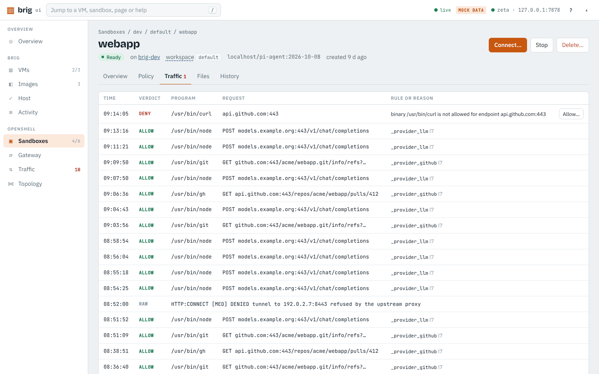
</picture>

Words: [Sandbox](glossary.md#sandboxes), [Provider](glossary.md#provider), [Placeholder](glossary.md#placeholder), [Sandbox policy](glossary.md#policies), [Workspace](glossary.md#workspace), [Audit trail](glossary.md#audit-trail).

How to: [Unblock an agent that cannot reach a host](glossary.md#unblock), [Keep the rules I added to a sandbox](glossary.md#keep-rules), [Rotate a provider's token](glossary.md#rotate-token), [See what a sandbox did and who changed its policy](glossary.md#look-back).

Tab `files`: [Sandbox](glossary.md#sandboxes).

Tab `history`: [Audit trail](glossary.md#audit-trail), [Sandbox policy](glossary.md#policies), [Drafted rule](glossary.md#draft).

Tab `policy`: [Base policy](glossary.md#base-policy), [Effective policy](glossary.md#effective-policy), [Policy file](glossary.md#policy-file), [Sandbox policy](glossary.md#policies).

Tab `traffic`: [Verdict](glossary.md#verdict), [Drafted rule](glossary.md#draft), [Fence 1, the sandbox policy](glossary.md#fence-1), [Audit mode](glossary.md#audit-mode).

### Gateway

What a VM's gateway holds, read live from it. Change it with sync and your config directories.

<picture>
  <source media="(prefers-color-scheme: dark)" srcset="../images/gateway-dark.png">
  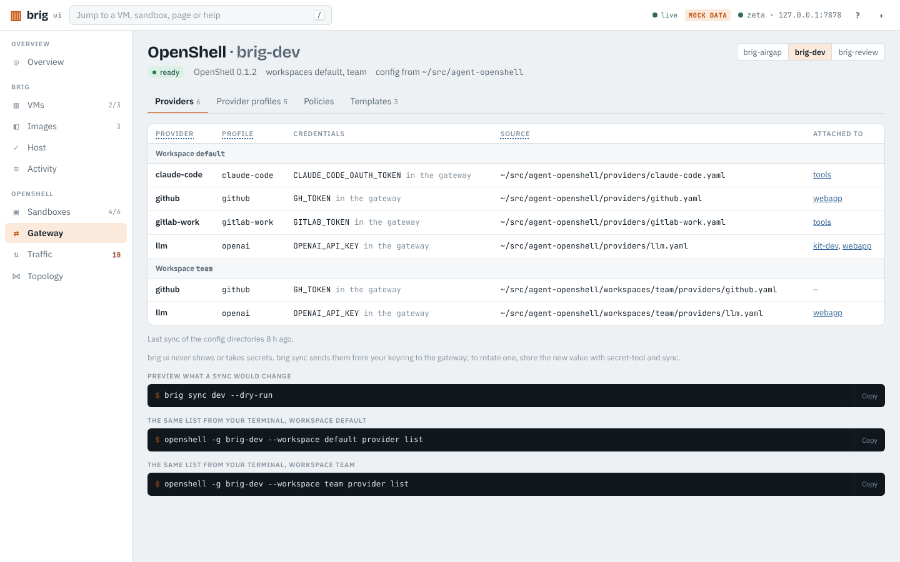
</picture>

Words: [Gateway](glossary.md#gateway), [Workspace](glossary.md#workspace), [Provider](glossary.md#provider), [Provider profile](glossary.md#provider-profile), [Sandbox template](glossary.md#template).

How to: [Rotate a provider's token](glossary.md#rotate-token), [Set up Claude Code, Pi or opencode](glossary.md#set-up-agent).

Tab `policies`: [Sandbox policy](glossary.md#policies), [Policy file](glossary.md#policy-file).

Tab `profiles`: [Provider profile](glossary.md#provider-profile), [Placeholder](glossary.md#placeholder).

Tab `providers`: [Provider](glossary.md#provider), [Sync](glossary.md#config-sync), [Config directory](glossary.md#config-dir).

Tab `templates`: [Sandbox template](glossary.md#template), [Sandbox image](glossary.md#sandbox-image).

### Traffic

Every request of every sandbox, as OpenShell's proxy decided it, live for the last hour and from the audit trail before.

<picture>
  <source media="(prefers-color-scheme: dark)" srcset="../images/traffic-dark.png">
  
</picture>

Words: [Verdict](glossary.md#verdict), [Fence 1, the sandbox policy](glossary.md#fence-1), [Drafted rule](glossary.md#draft), [Fence 2, the network profile](glossary.md#fence-2), [Audit trail](glossary.md#audit-trail).

How to: [Unblock an agent that cannot reach a host](glossary.md#unblock), [Find out why a request fails that the policy allows](glossary.md#blocked-outside), [See what a sandbox did and who changed its policy](glossary.md#look-back).

### Topology

Every path from this host to the endpoints sandboxes reach, and those they tried and could not.

<picture>
  <source media="(prefers-color-scheme: dark)" srcset="../images/topology-dark.png">
  
</picture>

Words: [Gateway](glossary.md#gateway), [Provider](glossary.md#provider), [Fence 1, the sandbox policy](glossary.md#fence-1).

How to: [Unblock an agent that cannot reach a host](glossary.md#unblock).

### Not found

This page does not exist. The jump box finds pages, VMs, sandboxes and help.

## Actions

### Start

Boots the VM, registers its gateway with your openshell CLI and syncs its config directories.

Runs: `brig start VM`

Undo: [Stop](#action-stop).

### Stop

Shuts the VM down. Its sandboxes stop with it; their workspaces stay.

Runs: `brig stop VM`

Undo: [Start](#action-start).

### Delete VM

Deletes the VM with its disks and gateway registration, and every sandbox and secret on it.

Runs: `brig delete VM`

**Cannot be undone. You type the name to confirm.**

Words: [Data disk](glossary.md#data-disk).

### Upgrade

Moves the VM onto the newest base image. The data disk stays; a failure rolls back.

Runs: `brig upgrade VM`

Words: [Base image](glossary.md#base-image), [Data disk](glossary.md#data-disk), [Root disk](glossary.md#root-disk).

### Add mount

Shares a host directory with the VM, at once if it runs, read-only unless you pick read-write.

Runs: `brig update VM --add-mount SOURCE:TARGET:ro`

<picture>
  <source media="(prefers-color-scheme: dark)" srcset="../images/mount-add-dark.png">
  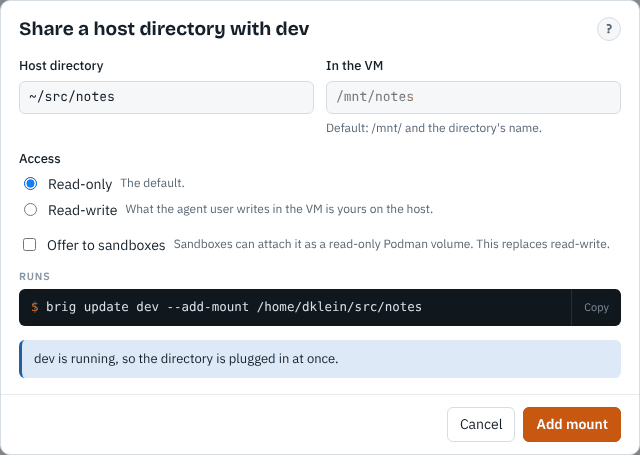
</picture>

Undo: Remove.

Words: [Host directory](glossary.md#mount), [Sandbox volume](glossary.md#sandbox-volume).

### Remove mount

Stops sharing the directory with the VM. The directory on the host stays.

Runs: `brig update VM --remove-mount TARGET`

Undo: [Add mount](#action-mount-add).

Words: [Host directory](glossary.md#mount).

### Change network profile

Picks what the whole VM may reach. Applies when the VM next starts.

Runs: `brig update VM --profile PROFILE`

Words: [Fence 2, the network profile](glossary.md#fence-2).

### Change resources

CPUs, memory and disk sizes. They apply when the VM next starts; disks can only grow.

Runs: `brig update VM --cpus N --memory SIZE`

Words: [Data disk](glossary.md#data-disk), [Root disk](glossary.md#root-disk).

### Add config directory

Adds a directory whose profiles, providers and default policy sync applies to this VM's gateway.

Runs: `brig update VM --add-openshell-config DIR`

Undo: Remove.

Words: [Config directory](glossary.md#config-dir), [Sync](glossary.md#config-sync).

### Remove config directory

Stops applying the directory to the VM. The directory itself stays.

Runs: `brig update VM --remove-openshell-config DIR`

Undo: Add directory.

Words: [Config directory](glossary.md#config-dir).

### New VM

Creates and starts a VM with its own gateway, building a base image first if there is none.

Runs: `brig create NAME`

<picture>
  <source media="(prefers-color-scheme: dark)" srcset="../images/new-vm-dark.png">
  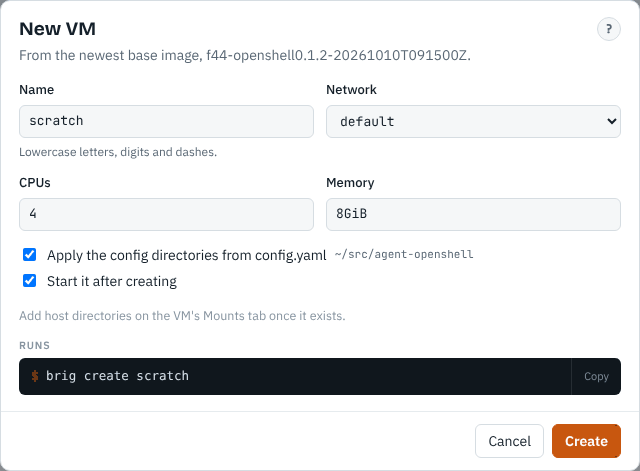
</picture>

Undo: Delete.

Words: [VM](glossary.md#vm), [Base image](glossary.md#base-image).

### Preview sync

Lists what a sync would change on the gateway, and where each secret may be sent. Changes nothing.

Runs: `brig sync VM --dry-run`

Words: [Sync](glossary.md#config-sync).

### Sync

Applies the config directories to the gateway. Secrets go from your keyring to the gateway, never through brig ui.

Runs: `brig sync VM`

Words: [Sync](glossary.md#config-sync), [Config directory](glossary.md#config-dir), [Provider](glossary.md#provider).

### Build base image

Builds Fedora with OpenShell using mkosi, without root. It takes a few minutes.

Runs: `brig image build`

Words: [Base image](glossary.md#base-image).

### Prune

Removes base images that no VM uses, except the newest, and mkosi's package cache.

Runs: `brig image prune`

**Removed images are not restored; brig image build makes a new one.**

Words: [Base image](glossary.md#base-image).

### Prune history

Deletes a VM's audit trail from before an age, or all of a deleted VM's, to free space.

Runs: `brig audit prune VM --before AGE`

**Deleted history cannot be restored. audit.retention in config.yaml does this by itself.**

Words: [Audit trail](glossary.md#audit-trail).

### Push an image

Copies a container image from your Podman into a VM, for sandboxes to run.

Runs: `brig image push VM IMAGE`

Words: [Sandbox image](glossary.md#sandbox-image).

### Allow

Turns a denied request into one rule for this sandbox only, or approves the rule OpenShell drafted for it.

Runs: `brig policy allow VM SANDBOX HOST:PORT --binary PATH`

<picture>
  <source media="(prefers-color-scheme: dark)" srcset="../images/allow-dark.png">
  
</picture>

Words: [Fence 1, the sandbox policy](glossary.md#fence-1), [Drafted rule](glossary.md#draft), [Audit mode](glossary.md#audit-mode), [Policy file](glossary.md#policy-file).

### Reject draft

Drops the rule OpenShell drafted. The sandbox's policy stays as it is.

Runs: `openshell rule reject SANDBOX --chunk-id ID`

Words: [Drafted rule](glossary.md#draft).

### Save to file

Shows how saving the rules added to the sandbox would change its policy file. Changes nothing.

Runs: `brig policy save VM SANDBOX --dry-run`

Words: [Policy file](glossary.md#policy-file), [Base policy](glossary.md#base-policy).

### Save rules to the policy file

Writes the rules the sandbox has and its policy file lacks into that file, keeping its comments.

Runs: `brig policy save VM SANDBOX`

Words: [Policy file](glossary.md#policy-file).

### New sandbox

Creates a sandbox for an agent, with the providers and host directories you pick.

Runs: `brig sandbox create VM -- --name NAME`

<picture>
  <source media="(prefers-color-scheme: dark)" srcset="../images/sandbox-create-dark.png">
  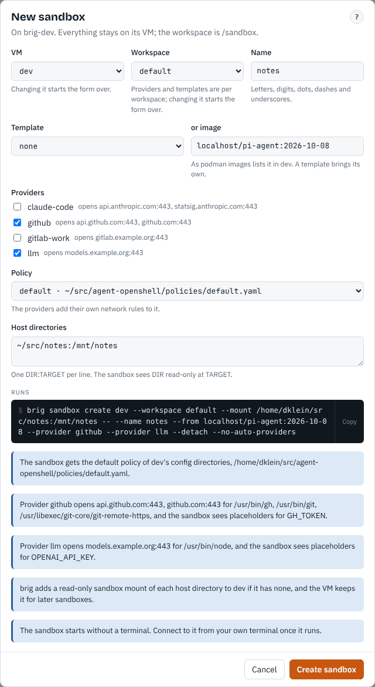
</picture>

Undo: Delete.

Words: [Sandbox](glossary.md#sandboxes), [Provider](glossary.md#provider), [Sandbox volume](glossary.md#sandbox-volume), [Sandbox template](glossary.md#template).

### Start sandbox

Starts the sandbox again with the /sandbox it had. Programs that ran in it are not restarted.

Runs: `openshell sandbox start SANDBOX`

Undo: [Stop](#action-stop).

### Stop sandbox

Stops every program in the sandbox. /sandbox, its providers and policy stay.

Runs: `openshell sandbox stop SANDBOX`

Undo: [Start](#action-start).

### Delete sandbox

Deletes the sandbox and its /sandbox directory.

Runs: `openshell sandbox delete SANDBOX`

**Cannot be undone. You type the name to confirm.**

### Attach provider

Gives the sandbox a credential as a placeholder, and opens the provider's endpoints for its programs.

Runs: `openshell sandbox provider attach SANDBOX PROVIDER`

Undo: Detach.

Words: [Provider](glossary.md#provider), [Placeholder](glossary.md#placeholder), [Effective policy](glossary.md#effective-policy).

### Detach provider

Takes the credential and the endpoints it opened away from the sandbox.

Runs: `openshell sandbox provider detach SANDBOX PROVIDER`

Undo: [Attach provider](#action-sandbox-attach).

Words: [Provider](glossary.md#provider).
